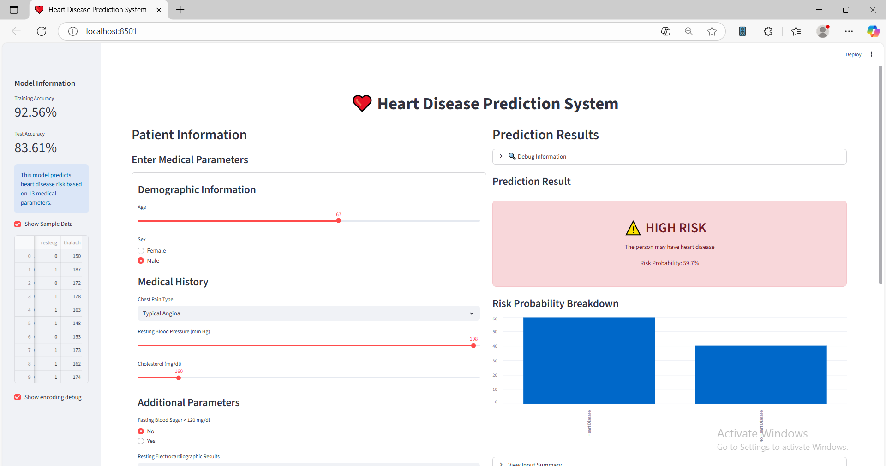
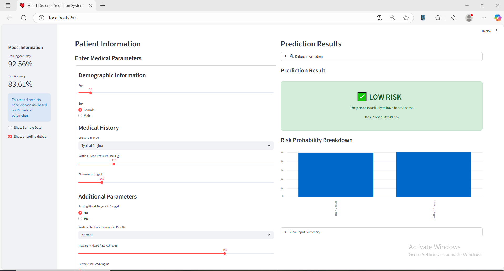

# HeartDiseasePredictor

> AI-powered heart disease prediction system — Logistic Regression model with a Streamlit web UI for interactive risk assessment.
> Built with **Python · Scikit-learn · Pandas · Streamlit**.

Repository: [https://github.com/AhmedDev374/HeartDiseasePredictor](https://github.com/AhmedDev374/HeartDiseasePredictor)

---

## Demo / Quick Gallery

* **Demo Video**  
[](https://drive.google.com/file/d/1vzDsx5USeR6WXMIWidd_AaWYdMfCKiuw/view?usp=sharing)


> Add screenshots to `/images/` and replace the paths below.

* **App Home / Input Form**  
  

---

## Table of Contents

* [Overview](#overview)
* [Features](#features)
* [Repository Structure](#repository-structure)
* [Prerequisites](#prerequisites)
* [Installation](#installation)
* [Usage](#usage)
  * [Run the Streamlit app (recommended)](#run-the-streamlit-app-recommended)
  * [Run `python main.py` to train & (optionally) launch UI](#run-python-mainpy-to-train--optionally-launch-ui)
* [Model & Data](#model--data)
* [Development tips](#development-tips)
* [.gitignore suggestion](#gitignore-suggestion)
* [Contact](#contact)
* [License](#license)

---

## Overview

`HeartDiseasePredictor` is a simple, explainable machine learning system that predicts the probability of heart disease from 13 clinical features. It includes:

* Data ingestion and preprocessing
* Feature scaling (StandardScaler)
* Logistic Regression model training and evaluation
* Interactive Streamlit UI for entering patient parameters and seeing prediction + probability breakdown

This repo is suitable for demos, education, and as a starting point for further research (add more models, dataset, feature engineering, model explainability).

---

## Features

* Train a Logistic Regression model on `heart_disease_data.csv`.
* Streamlit UI for real-time prediction and visualization.
* Shows training and test accuracy in the sidebar.
* Input summary and probability chart for user inputs.

---

## Repository Structure

```
HeartDiseasePredictor/
├── app.py                  # Streamlit UI
├── main.py                 # training + prediction functions (can act as launcher)
├── heart_disease_data.csv  # dataset (must be present)
├── requirements.txt
├── images/                 # (optional) screenshots for README
└── README.md
```

---

## Prerequisites

* Python 3.8+
* pip

Recommended: create and use a virtual environment.

---

## Installation

```bash
# clone
git clone https://github.com/AhmedDev374/HeartDiseasePredictor.git
cd HeartDiseasePredictor

# create venv (optional but recommended)
python -m venv .venv
# Windows
.venv\Scripts\activate
# macOS / Linux
source .venv/bin/activate

# install dependencies
pip install -r requirements.txt
```

**Example `requirements.txt`:**

```
pandas
numpy
scikit-learn
streamlit
joblib
```

---

## Usage

### Run the Streamlit app (recommended)

This will start the interactive UI in your browser:

```bash
streamlit run app.py
```

Open `http://localhost:8501` and use the sidebar / form to enter patient parameters and get risk predictions.

---

### Run `python main.py` to train & (optionally) launch UI

By default `main.py` trains and prints accuracies and an example prediction:

```bash
python main.py
```

If you want `python main.py` to also open the Streamlit UI automatically, replace the `if __name__ == "__main__":` block in `main.py` with the launcher snippet:

```python
if __name__ == "__main__":
    import os
    # trains model (existing main function) then launches Streamlit
    main()
    # launch streamlit app (will run a new process, ensure Streamlit is installed)
    os.system("streamlit run app.py")
```

> **Recommendation:** instead of retraining on every start, save the trained model to disk with `joblib` and load it in `app.py`. This makes app startup fast and avoids repeated training.

**Save model example (in `main.py`):**

```python
from joblib import dump, load

# after training
dump(model, "model.joblib")
dump(scaler, "scaler.joblib")
```

**Load in `app.py`:**

```python
from joblib import load
model = load("model.joblib")
scaler = load("scaler.joblib")
```

---

## Model & Data

* Dataset file expected: `heart_disease_data.csv` in repo root.
* Model: `sklearn.linear_model.LogisticRegression` (configured with `max_iter=2000`).
* Features (order expected by the code; ensure your dataset columns match):
  `['age','sex','cp','trestbps','chol','fbs','restecg','thalach','exang','oldpeak','slope','ca','thal']`

**Input encoding notes (used in UI / prediction):**

* `sex`: Male=1, Female=0
* `cp` (chest pain): 0..3 (mapping used in UI: Typical=0, Atypical=1, Non-anginal=2, Asymptomatic=3)
* `fbs`: >120 mg/dl → 1 else 0
* `restecg`: 0..2
* `exang`: Yes=1, No=0
* `slope`: 0..2
* `ca`: integer 0..3
* `thal`: 1..3 (mapping in UI increments by +1)

---

## Development tips

* If you add new features or modify feature order, update `feature_names` accordingly.
* To speed up development, save intermediate preprocessed datasets to a `data/` folder and check in small sample CSVs (avoid sensitive data).
* Add model explainability (SHAP/LIME) to help interpret predictions for users.
* Add unit tests for `predict_heart_disease()` to guard against feature-order mismatches.

---

## .gitignore suggestion

```
# Byte-compiled / python
__pycache__/
*.py[cod]
*.pyo
.venv/
.env

# Jupyter
.ipynb_checkpoints

# OS files
.DS_Store
Thumbs.db

# IDE
.idea/
.vscode/

# Model artifacts
*.joblib
model.joblib
scaler.joblib
```

---

## Contact

For questions or collaboration, contact Ahmed Atef:

* LinkedIn: [https://eg.linkedin.com/in/ahmed-atef-elnadi-8165a51b9](https://eg.linkedin.com/in/ahmed-atef-elnadi-8165a51b9)
* GitHub: [https://github.com/AhmedDev374](https://github.com/AhmedDev374)

---

## License

This project is licensed under the **GNU General Public License v3.0 (GPL-3.0)** — see [LICENSE](LICENSE) for details.

